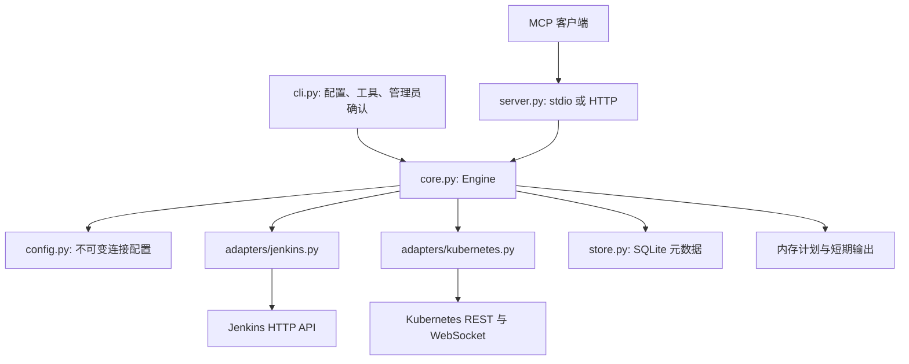

# 整体架构

首版已实现。对外契约见 SPEC，选型理由见 DECISIONS，部署事实见 DEPLOYMENT。

## 组件与布局

| 文件 | 职责 |
| --- | --- |
| cli.py、__main__.py | CLI 启动、配置检查、工具 schema 导出、独立管理员确认 |
| config.py | 严格配置模型、连接解析、凭据引用及目标指纹 |
| server.py | 实际工具注册、annotations、结构化结果、身份及 HTTP 访问边界 |
| catalog.py | 能力与实际工具的对应关系，平台依赖和限制 |
| core.py | 固定计划、去重、执行、续查、取消、输出预算和生命周期 |
| store.py | 单服务锁、SQLite 原子认领、状态和回执，HMAC 请求指纹 |
| adapters/jenkins.py | Job/XML/Pipeline、参数、Queue/Build、日志及报告 |
| adapters/kubernetes.py | 独立认证、动态资源、dry-run、工作负载、排障和 exec |
| security.py、errors.py | 尽力脱敏、安全错误和必要对象摘要 |
| tests/ | 假 IO 失败路径、模拟 HTTP/WS 平台和真实 SDK 协议进程测试 |

Python 包在 src/jenkins_k8s_mcp，使用 hatchling 构建。Python 3.12、MCP SDK 1.29.0、httpx、官方 kubernetes 动态客户端、lxml、Pydantic、PyYAML 和 uvicorn 的实际依赖锁在 uv.lock。

## 内部数据流

查询：协议入口取得传输身份 → 解析连接与对象 → 延迟建立独立平台客户端 → 平台读取 → 必要脱敏 → 有界结果或短期 JSON 快照。

变更：固定连接及完整参数 → 读取原始对象 → 预览和平台预检 → SQLite 建立操作及去重索引 → 根据连接策略取得可选管理员批准 → 事务认领 → 仅提交一次 → 保存原生回执 → 后续按回执查询。

计划载荷与预览放在进程内存，SQLite 仅存必要目标、前置版本、状态、回执和 HMAC 指纹。认领发生在副作用之前，进程在提交边界退出时保留 unknown。长期历史不因 TTL 或恢复而自动删除。

K8s REST 调用通过有界线程与超时封装同步 SDK。每个连接使用独立 Configuration、明确 context 和独立 discovery 缓存；禁用写重试，不修改全局 current-context。已有对象使用原生版本条件，缺失对象的 apply 使用原子创建，细节归 SPEC。

exec 使用专用 ApiClient，避免 SDK stream 临时替换 transport 干扰同一连接的并发 REST。后台线程读取有限 stdout/stderr，执行核心异步记录完成状态；关闭服务时关闭通道并等待本地线程收尾。未知远端状态不转换成成功。

Jenkins 使用不跟随重定向的 httpx 客户端、原生 HTTP 端点和 lxml；XML 未知节点与注释保留。平台不具备原子配置版本条件时，实施尽力复核并在结果中明确边界。

HTTP 生命周期属于整个服务，短期 stateless 协议会话结束不关闭执行核心。两种传输调用同一个 Engine，后台业务状态不依赖单个客户端会话存活。

## 结构约束

- 配置与使用者标签不侵入平台适配器，不能加入组织级对象白名单。
- 所有通用资源变更和 exec 同样经过固定目标、策略、认领与记录机制。
- 工具注册和能力目录必须对应实际实现，schema 从代码取得，不维护虚假工具列表。
- 敏感原始数据仅在必要请求和短期内存中流转，不能以脱敏过滤代替持久化边界。
- 不创建第二套 HTTP 业务核心，不调用 shell 切换 kubeconfig 或拼接 exec 命令。
- 平台受理、资源收敛和业务验收保持独立。
