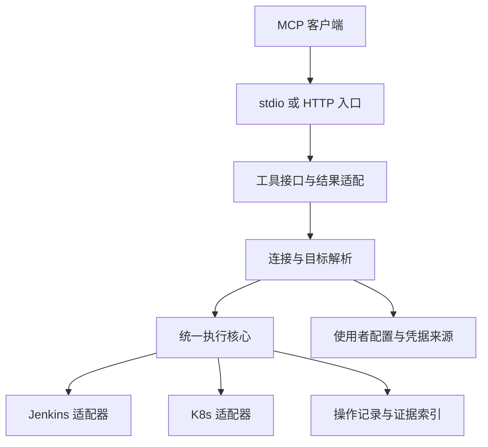

# 整体架构

已确定组件边界，尚未实现。选型理由见 DECISIONS，对外对象与状态语义见 SPEC。

## 组件

- MCP 入口处理协议、认证和生命周期；两种传输不各自复制业务逻辑。
- 连接注册表解析地址、认证引用、kubeconfig context、连接策略和可选分组。
- 目标解析将请求绑定到明确平台对象，并支持名称或 API 发现。
- 执行核心处理查询、变更计划、执行、重复请求保护、状态跟踪和审计。
- Jenkins 适配器处理原生 Job、配置、Queue、Build 和日志。
- K8s 适配器处理资源 discovery、通用对象操作、工作负载动作、诊断与 exec。
- 操作存储保存本次操作和原生回执的关联；轻量本地持久化默认考虑 SQLite。

## 内部设计默认值

实现默认采用 Python，Jenkins 使用原生 HTTP API，K8s 使用能尊重 kubeconfig 认证并支持动态资源的客户端。具体 SDK 与依赖版本在编码时验证并锁定。

平台通用操作与常用任务分层。Jenkins 配置保留原生完整表达，结构化修改尽量只触及目标字段；K8s 通用资源能力补充重启、扩缩容和诊断等任务工具。

排障聚合客观证据与确定性检查，不内置独立 LLM 推理服务。平台扩展缺失时返回部分结果和缺口。

## 数据流

查询：请求 → 解析连接与对象 → 平台查询 → 有界结果与证据。

变更：请求 → 解析并固定目标 → 读取必要状态 → 生成精确计划 → 根据连接与客户端策略取得授权 → 执行固定计划 → 保存原生回执 → 跟踪与核验。

K8s 使用适用的服务端 dry-run 与原生版本条件。Jenkins 依据具体 API 做配置复核，并明确其并发与幂等能力；不把两平台抽象成不存在的统一事务。

长操作使用本地操作 ID 关联原生目标；响应等待有界，后续调用可继续查询。超时与未知状态保留证据，不触发隐式重复写入。

## 结构约束

- 配置与业务标签不侵入平台适配器。
- 通用资源操作同样经过统一的目标、策略和记录机制。
- 敏感数据生命周期独立设计，长期记录不得复制敏感载荷。
- 不通过调用客户端 shell 改写全局 context 来实现连接选择。
- 不创建未经实现的平台操作代理，不把任意命令字符串当成所有能力的唯一接口。
- 路径布局在首轮编码时确定，本阶段不创建空源码模块或虚假构建脚本。
